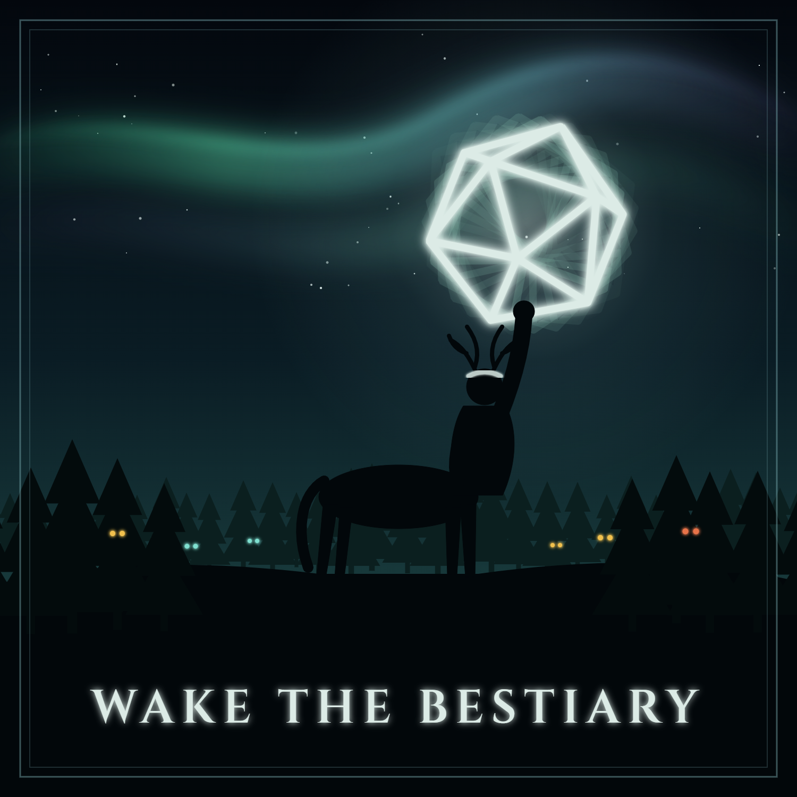

# Wake the Bestiary -DnDGen.CreatureGen Theme-

[](TODO_SUNO_LINK)

The DnDGen.CreatureGen theme song: dark Nordic folk for the bestiary, sung in the first person by the Centaur King, keeper of every creature, while a circle of low voices answers him.
Its lyrics come from the [DnDGen.CreatureGen README](https://github.com/DnDGen/DnDGen.CreatureGen/blob/main/README.md), sung in plain English as unrhymed alliterative verse, after the old Nordic poems,
and the circle answers with *Centaur Rege*, the king's name in Latin and CreatureGen's leitmotif from the [DnDGen main theme](https://github.com/DnDGen/.github/blob/main/theme-song/README.md).

**Listen on [Suno](TODO_SUNO_LINK).**

## Updating

This song follows the [DnDGen.CreatureGen README](https://github.com/DnDGen/DnDGen.CreatureGen/blob/main/README.md).
Every pull request that changes the README gets a song check:

1. If the change rewords or removes a phrase in the Sources table below, the song needs updating.
   The tests catch this one: they fail and list every quoted phrase that is no longer in the README.
2. Otherwise, if the change alters the README's high-level ideas or vibe, the song needs updating.
3. Otherwise, it doesn't. Changes to the README's Theme Song badge or section never need a song update.

When the song needs updating, it happens in the same pull request:

1. The contributor updates the Lyrics and Sources here to match the new README.
   Names are sung as words, never as code. Keep the verse form: two lines, then the circle's answer,
   with the stressed words of each line starting alike instead of rhyming.
2. The maintainer makes the new song in Suno:
   - **Cover the current song**, so the theme stays recognizably the same song as it evolves.
   - Use the Title, Style, and Lyrics from this page. **Leave the Style as it is**: only the lyrics change.
   - **Turn Variety all the way down**, so Suno keeps to the Style instead of straying from it.
   - Pick the take. The new take replaces the old one.
   - **Publish it**, so anyone with the link can find and hear it.
3. The maintainer updates the Suno link here and in the README, and adds anything learned to the Suno Notes.

## Title

```
Wake the Bestiary -DnDGen.CreatureGen Theme-
```

## Style

```
Dark Nordic folk, a slow, hypnotic, ritual pulse in a minor mode, Frame drum and deep war drums, a bowed tagelharpa drone, nyckelharpa, kantele, bone flute and a low jaw harp, with wind and a crackling fire beneath, A calm, deep, unhurried male voice, a regal king and storyteller speaking of himself, steady and clear, every word plain, shaped like a story told by the fire, Call and response throughout: the king sings each pair of lines, and a small circle of low male and female voices answers after every pair, with the Latin name in the choruses and a short echo in the verses, A hushed bridge, whispered and conspiratorial, Slow, steady tempo throughout, Cold, wide, earthy, live-in-the-forest production, Ancient, patient and ominous
```

## Lyrics

```
[Intro - the Centaur King sings the English, speaking of himself, the circle of low voices answers with the Latin name, slow drone and frame drum]
I am the Centaur King, keeper of the creatures
Hoof and hand, half horse, half man
— Centaur Rege
I wake each beast, the brood and the breed
Hear the king call, hearken and heed
— Centaur Rege

[Verse 1 - the king sings the English, the circle of low voices answers with a short echo, slow and spare]
Ask for an ogre and an ogre awakens
Hit dice and hit points, held in its hide
— Held in its hide!
Skills and feats, spells and strikes
All that it carries, kept in its keeping
— Kept in its keeping!

[Chorus - the king sings the English, the circle of low voices answers with the Latin name]
Wake the bestiary, woken by the king
— Centaur Rege
Each creature fleshed out, flesh, fur, and fang
— Centaur Rege
Hero or horror, as you will it
— Centaur Rege

[Verse 2 - the king sings the English, the circle of low voices answers with a short echo, slow and spare]
Playable peoples who take class levels
Templates chained, taken in turn
— Taken in turn!
Each must suit what stands before it
Fit the form the first has fashioned
— Fit the form!

[Chorus - the king sings the English, the circle of low voices answers with the Latin name]
Wake the bestiary, woken by the king
— Centaur Rege
Each creature fleshed out, flesh, fur, and fang
— Centaur Rege
Hero or horror, as you will it
— Centaur Rege

[Verse 3 - the king sings the English, the circle of low voices answers with a short echo, slow and spare]
Rolled by the default roll, the scores are set
Or four dice fall, the fairest three keep
— The fairest three!
A ghost needs Charisma, six at the least
Short of the mark, the score is raised to meet it
— Raised to meet it!
If the roll can never reach the number
Not compatible, the creature cannot come
— It cannot come!

[Chorus - the king sings the English, the circle of low voices answers with the Latin name]
Wake the bestiary, woken by the king
— Centaur Rege
Each creature fleshed out, flesh, fur, and fang
— Centaur Rege
Hero or horror, as you will it
— Centaur Rege

[Bridge - hushed, whispered and conspiratorial, the king almost speaking, the circle echoing under his breath]
Ask before you wake it, whether it can wake
Valid, says the verifier, a creature can be woken
— Can be woken!
Where none can wake, the generator throws
The warning wails through the whole bestiary
— The warning wails!

[Verse 4 - the king sings the English, the circle of low voices answers with a short echo, slow and spare]
Or let the dice decide, and the dice will choose
Weighted heavily to the creature that wears no template
— Weighted heavily!
Filters narrow the field of the fray
Match any one of the marks and it may pass
— It may pass!
Choose a challenge, and the creature will hold
Never advanced, never altered, never more
— Never more!

[Chorus - the king sings the English, the circle of low voices answers with the Latin name]
Wake the bestiary, woken by the king
— Centaur Rege
Each creature fleshed out, flesh, fur, and fang
— Centaur Rege
Hero or horror, as you will it
— Centaur Rege

[Verse 5 - the king sings the English, the circle of low voices answers with a short echo, slow and spare]
Version two has broken with the old ways
Dot net ten, the need of the new
— The need of the new!
Load it with the module loader, and let it lead
RollGen and Infrastructure and TreasureGen, three that travel with it
— Three that travel!

[Final Chorus - the king sings the English, the circle of low voices answers with the Latin name]
Wake the bestiary, woken by the king
— Centaur Rege
Each creature fleshed out, flesh, fur, and fang
— Centaur Rege
Hero or horror, as you will it
— Centaur Rege

[Outro - the king sings the English, the circle of low voices answers with the Latin name, the drums fade and the drone remains]
The bestiary sleeps till you summon it again
Keeper, king, I keep the watch
— Centaur Rege
```

## Sources

The Centaur King is the song's narrator. He is not in the README: he is *Centaur Rege*, Latin for a centaur, by the king, CreatureGen's anagram from the [main theme](https://github.com/DnDGen/.github/blob/main/theme-song/README.md#leitmotifs), and the circle answers with his name. An echo shares the source of the line it answers.

The lines are unrhymed alliterative verse: each line has two or three stressed words that start alike, as in the old Nordic poems (*keeper of the creatures*, *fleshed out, flesh, fur, and fang*, *Valid, says the verifier*).

| Lyric | From the README |
| --- | --- |
| I am the Centaur King, keeper of the creatures<br>Hoof and hand, half horse, half man<br>— Centaur Rege<br>I wake each beast, the brood and the breed<br>Hear the king call, hearken and heed | Not from the README: the Centaur King introduces himself, and the circle sings his name, CreatureGen's leitmotif from the main theme |
| Ask for an ogre and an ogre awakens<br>Hit dice and hit points, held in its hide<br>— Held in its hide! | Use: "Generating a specific creature"; Reference, Creature: "Its hit dice and hit points" |
| Skills and feats, spells and strikes<br>All that it carries, kept in its keeping<br>— Kept in its keeping! | Reference, Creature: "Its skills", "Its feats", "All of its attacks", "Its spells and casting", and "What it carries" |
| Wake the bestiary, woken by the king | Not from the README: the refrain and the song's title |
| Each creature fleshed out, flesh, fur, and fang | Introduction: "fleshed-out creature" |
| Hero or horror, as you will it | Use: "generated as a character" and "or as a monster" |
| Playable peoples who take class levels<br>Templates chained, taken in turn<br>— Taken in turn! | Use: "a playable race that will take class levels", "Chaining templates", and "applied in the order given" |
| Each must suit what stands before it<br>Fit the form the first has fashioned<br>— Fit the form! | Use: "Each template must be compatible with the creature" and "as it is after the templates before it have been applied" |
| Rolled by the default roll, the scores are set<br>Or four dice fall, the fairest three keep<br>— The fairest three! | Use, Ability scores: "abilities are rolled with the default roll" and "keep the highest 3" |
| A ghost needs Charisma, six at the least<br>Short of the mark, the score is raised to meet it<br>— Raised to meet it! | Use, Ability scores: "Some templates require a minimum ability score", "a Ghost needs Charisma 6", and "any rolled score that would fall short is raised to meet the minimum" |
| If the roll can never reach the number<br>Not compatible, the creature cannot come<br>— It cannot come! | Use, Ability scores: "If the randomizer can never reach the minimum" and "the creature is not compatible" |
| Ask before you wake it, whether it can wake<br>Valid, says the verifier, a creature can be woken<br>— Can be woken! | Use, Checking compatibility: "To check ahead of time", "ICreatureVerifier", and "gives a valid creature" |
| Where none can wake, the generator throws<br>The warning wails through the whole bestiary<br>— The warning wails! | Use, Checking compatibility: "the generator throws" |
| Or let the dice decide, and the dice will choose<br>Weighted heavily to the creature that wears no template<br>— Weighted heavily! | Use: "Random creatures"; Use, Random creatures: "weighted heavily in favor of creatures without a template" |
| Filters narrow the field of the fray<br>Match any one of the marks and it may pass<br>— It may pass! | Use, Filters: "Filters narrow down which random creatures are valid" and "A creature satisfies a filter if it matches" |
| Choose a challenge, and the creature will hold<br>Never advanced, never altered, never more<br>— Never more! | Use, Filters: "challenge rating filter" and "are never advanced" |
| Version two has broken with the old ways<br>Dot net ten, the need of the new<br>— The need of the new! | Upgrading from 1.x: "Version 2.0.0 has breaking changes"; Installing: "It targets .NET 10." |
| Load it with the module loader, and let it lead<br>RollGen and Infrastructure and TreasureGen, three that travel with it<br>— Three that travel! | Getting the Generators: "use the Module Loader" and "including RollGen, Infrastructure, and TreasureGen" |
| The bestiary sleeps till you summon it again<br>Keeper, king, I keep the watch | Not from the README: the Centaur King signs off, and the circle sings his name once more |

## Suno Notes

Nothing has been generated yet, so everything here is a guess to test:

- **Drafts and the Sample.** Every draft before this song first merges is a fresh generation that
  Samples the main theme's "Rogante Marendor" snippet (3:00.0 to 3:17.1) with Variety all the way
  down, per the main theme's
  [New Theme Songs](https://github.com/DnDGen/.github/blob/main/theme-song/README.md#new-theme-songs).
  The take that merges is v1; every update from there Covers it.
- **The leitmotif is the narrator.** v0.1's *Centaur Rege* was a bare Latin answer with nothing in
  the song to explain it. Now the Centaur King introduces himself in the first person, with centaur
  and king imagery (half horse, half man; "hear the king call"; "woken by the king"), and the
  circle answers with his name. The Latin is still two words, and whether Suno sings them as Latin
  is untested.
- **Call and response is the style that worked.** The circle's answers are ordinary lines, each
  after a pair of lines, with an em dash for the reader, not parentheses. Infrastructure's v0.5 and
  v0.6 and TreasureGen's drafts got the second voice this way, with the voices assigned in each
  section's tag and the Style, and no inline voice tags. Infrastructure's parenthesized echoes were
  dropped almost every time. The verses and bridge answer with a short English echo of the last
  words, and the choruses and the intro and outro answer with the Latin name.
- **No rhyme, by design.** The old Nordic poems don't end-rhyme: Eddic verse is alliterative and
  skaldic verse rhymes inside the line. Dark Nordic folk draws on them, and Credo of the Tables
  doesn't rhyme either, because the genre doesn't. v0.2 rhymed every couplet to match the other
  songs; v0.3 drops that for alliteration, the Nordic way: two or three stressed words in a line
  start alike, and each line is a long line with a pause in the middle. It follows the alliterative
  form loosely, since the lines must also be true of the README. Whether Suno's melody still lands
  without rhyme to lean on is untested.
- **Five choruses, one after each of verses 1 to 4, and a final one.** v0.1 skipped the chorus after
  verse 3, and v0.2 the one after verse 4.
- **The singer is a guess.** "A calm, deep, unhurried male voice, a regal king and storyteller"
  names the singer, as RollGen's lesson says, and avoids "raspy" and "gravelly", which came out
  growly there. A dark Nordic folk take may still pull toward a throat-sung or growled voice.
- **The Sample pulls toward the orchestra.** The Style names the Nordic instruments (tagelharpa,
  nyckelharpa, kantele, bone flute, jaw harp) to counter it, as Web's Kit Kat band and TreasureGen's
  squeezebox did. This song wants a band, so naming them is fine, unlike Infrastructure's a cappella
  chant.
- **Pace.** The Style says slow twice, and "Slow, steady tempo throughout" and the verse tags say it
  again, because the Sample's cinematic swell tends to build over a song.
- **Length.** About 4,000 characters of lyrics, with the chorus sung five times. Slow chant
  ran about 460 characters a minute and TreasureGen's shanty about 880, so this lands anywhere from
  about four to eight minutes, and eight is Suno's cap. If a take runs long, cut the chorus repeats
  first.
- **"Dot net ten"** is spelled out so Suno doesn't read ".NET" as a symbol.

## Album Art

[cover.png](cover.png) is rendered from [cover.html](cover.html), which you can open in any browser.
To render it again at 1500 × 1500, from this folder:

```
msedge --headless --hide-scrollbars --allow-file-access-from-files --window-size=1500,1500 --screenshot=cover.png cover.html
```

If Edge reads `cover.html` as a web address, pass it as a full `file:///` URL instead.

- It is the main theme's [cover](https://github.com/DnDGen/.github/blob/main/theme-song/cover.html), recoloured for the bestiary.
  The d20 is bone-pale in the cold light of a northern forest, and the ghost copies behind it are the
  spruce-green shadows of every beast it has woken. The title is the song's, *Wake the Bestiary*.
- The d20 is the dndgen.com loading spinner, from [DnDGen.Web](https://github.com/DnDGen/DnDGen.Web/blob/main/dndgen-web/src/assets/loadingDice.svg), originally from [a gist by hperantunes](https://gist.github.com/hperantunes/f4c2fd407c2ea74c6c9d).
- The title is set in [Cinzel](https://github.com/NDISCOVER/Cinzel), included as [Cinzel.ttf](Cinzel.ttf) under the [SIL Open Font License](Cinzel-OFL.txt).
